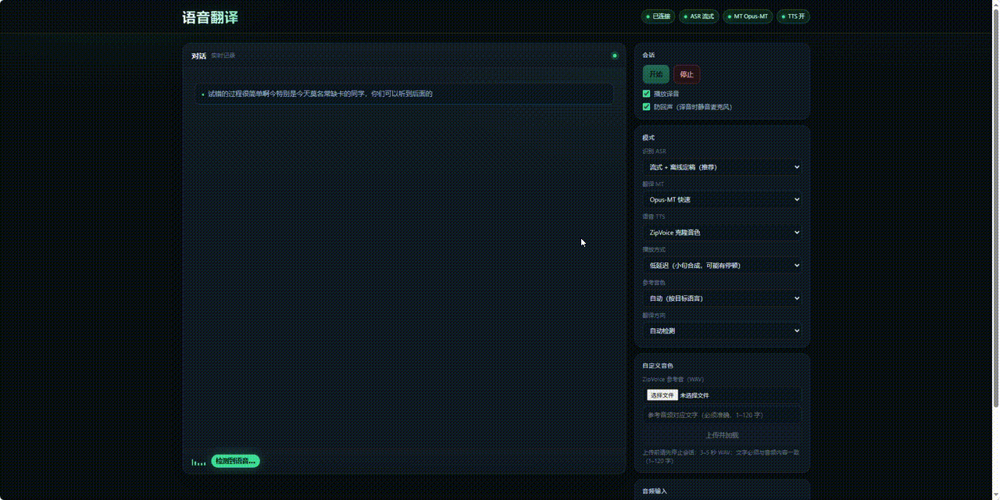

# Speech-Translation

AX650N 端侧实时语音翻译。

**默认链路**

`TEN-VAD` → `SenseVoice 流式 + 离线定稿` → `Opus-MT` → `ZipVoice 语音克隆`

**可选模块**

`Zipformer 流式 ASR` · `FireRedPunc 标点` · `Qwen3-0.6B 翻译`

- 上游: [SenseVoice](https://github.com/FunAudioLLM/SenseVoice) · [Zipformer](https://github.com/k2-fsa/icefall) · [FireRedPunc GitHub](https://github.com/ZY-2012/FireRedPunc.AXERA) · [HuggingFace](https://huggingface.co/HY-2012/FireRedPunc.AXERA) · [Opus-MT](https://github.com/Helsinki-NLP/OPUS-MT) · [Qwen3](https://github.com/QwenLM/Qwen3) · [TEN-VAD](https://github.com/TEN-framework/ten-vad) · [ZipVoice](https://github.com/k2-fsa/ZipVoice) · [ax-llm](https://github.com/AXERA-TECH/ax-llm)

<p align="center">
  <code>语音翻译</code>　<code>克隆语音</code>　<code>流式识别</code>　<code>离线定稿</code>　<code>端侧推理</code>
</p>

<p align="center"></p>

## 目录结构

```text
Speech-Translation/
├── app/                     # 服务端、VAD、ASR、MT、TTS
│   ├── pipeline.py          # TEN-VAD → ASR → Punc（可选）→ MT → TTS
│   ├── server.py            # HTTP / HTTPS + WebSocket
│   ├── asr_stream.py        # 流式 SenseVoice / Zipformer
│   ├── asr_offline.py       # 离线 SenseVoice
│   ├── punc.py              # FireRedPunc 客户端（可选）
│   ├── punc_worker.py
│   ├── opus_mt.py
│   ├── llm_axllm.py
│   ├── tts_service.py
│   ├── tts_zipvoice.py
│   ├── vad_ten.py
│   └── number_text.py
├── config/                  # 运行配置
│   ├── board.yaml
│   ├── board50.yaml
│   ├── board50_zf.yaml
│   ├── default.yaml
│   └── tls/                 # 自签名证书
├── scripts/
│   ├── run_board.sh
│   ├── download_models.sh
│   ├── ws_client.py
│   └── ws_wav.py
├── static/
│   └── index.html           # 单对话流页面
├── samples/                 # 16 kHz 示例音频
├── models/                  # 模型目录
│   ├── asr_chain/           # SenseVoice + TEN-VAD
│   ├── asr_official/        # 离线 ASR
│   ├── opus_mt/
│   ├── qwen3-0.6b/          # 可选
│   └── zipvoice/            # ZipVoice + vocoder
├── third_party/
│   ├── asr/                 # libax_asr_api + stream-asr-worker
│   ├── ten_vad/
│   ├── llm/axllm            # AXERA ax-llm 编译产物
│   ├── opus_mt/src/
│   ├── zf/                  # Zipformer worker（可选）
│   └── zipvoice/src/
├── runtime/                 # 板端 Python + pylibs
├── Speech_Translation.gif
└── README.md
```

`third_party/llm/axllm` 的源码：[AXERA-TECH/ax-llm](https://github.com/AXERA-TECH/ax-llm)。

## 快速开始

1. 准备模型。默认链路只需要以下目录，或运行脚本自动下载：

   ```bash
   bash scripts/download_models.sh
   ```

   - `models/asr_chain/asr/sensevoice/`：SenseVoice 离线 + 流式
   - `models/asr_official/sensevoice_ax650/`：离线 ASR
   - `models/asr_chain/vad/ten-vad/`：TEN-VAD
   - `models/opus_mt/`：Opus-MT
   - `models/zipvoice/`：ZipVoice + vocoder

   Qwen3、Zipformer、FireRedPunc 是可选模型，脚本不下载。

2. 按实际路径修改 `config/board.yaml`。

3. 启动：

   ```bash
   bash scripts/run_board.sh
   ```

4. 浏览器打开 `https://<板端IP>:8444/`，允许麦克风即可。

## 模型

| 模块 | axmodel | 来源 |
| --- | --- | --- |
| ASR | `sensevoice.axmodel` / `streaming_sensevoice.axmodel` | [AXERA-TECH/models-for-asr-chain](https://huggingface.co/AXERA-TECH/models-for-asr-chain) · [HY-2012/Tmp_Models](https://huggingface.co/HY-2012/Tmp_Models) |
| VAD | `ten-vad.axmodel` | [models-for-asr-chain](https://huggingface.co/AXERA-TECH/models-for-asr-chain) |
| 标点（可选） | `punc.axmodel` | [FireRedPunc GitHub](https://github.com/ZY-2012/FireRedPunc.AXERA) · [HuggingFace](https://huggingface.co/HY-2012/FireRedPunc.AXERA) |
| 流式 ASR（可选） | Zipformer axmodel | [HY-2012/zipformer_streaming.axera](https://huggingface.co/HY-2012/zipformer_streaming.axera) |
| Opus-MT | `encoder.axmodel` / `decoder.axmodel`（zh-en、en-zh） | [HY-2012/Opus-MT.AXERA](https://huggingface.co/HY-2012/Opus-MT.AXERA) · [源码](https://github.com/ZY-2012/Opus-MT.AXERA) |
| Qwen3-0.6B（可选） | `qwen3_*.axmodel` / `qwen3_post.axmodel` | [AXERA-TECH/Qwen3-0.6B-GPTQ-Int4](https://huggingface.co/AXERA-TECH/Qwen3-0.6B-GPTQ-Int4) |
| ZipVoice | `encoder.axmodel` / `decoder_part0..3.axmodel` | [AXERA-TECH/ZipVoice.AXERA](https://huggingface.co/AXERA-TECH/ZipVoice.AXERA) · [源码](https://github.com/AXERA-TECH/ZipVoice.AXERA) |
| Vocoder | `vocos_full.axmodel` | [ZipVoice.AXERA](https://huggingface.co/AXERA-TECH/ZipVoice.AXERA) · [vocos-mel-24khz](https://huggingface.co/charactr/vocos-mel-24khz) |

## 页面

- ASR：流式 + 离线定稿 / 仅离线定稿
- MT：Opus-MT / Qwen / 关闭翻译
- TTS：ZipVoice 克隆 / 关闭；低延迟 / 连贯；参考音色自动 / 英文 / 中文
- 自定义音色：上传 3–5 秒 WAV，填写对应文字，加载完成后可选
